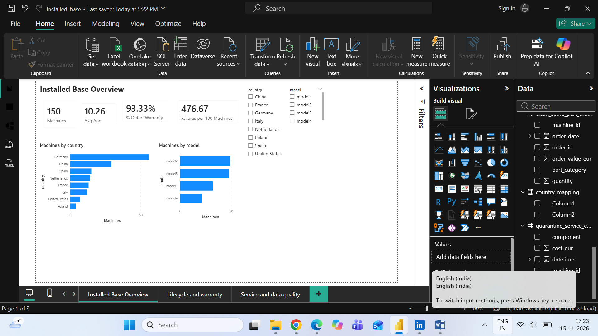
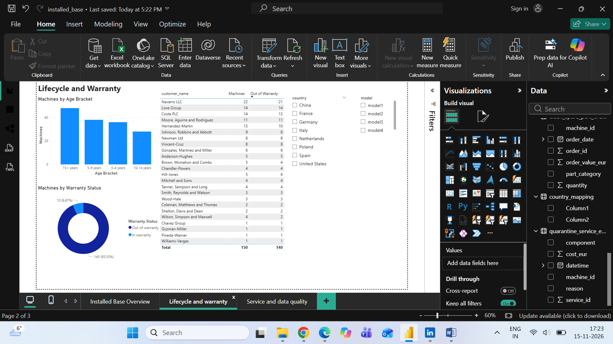
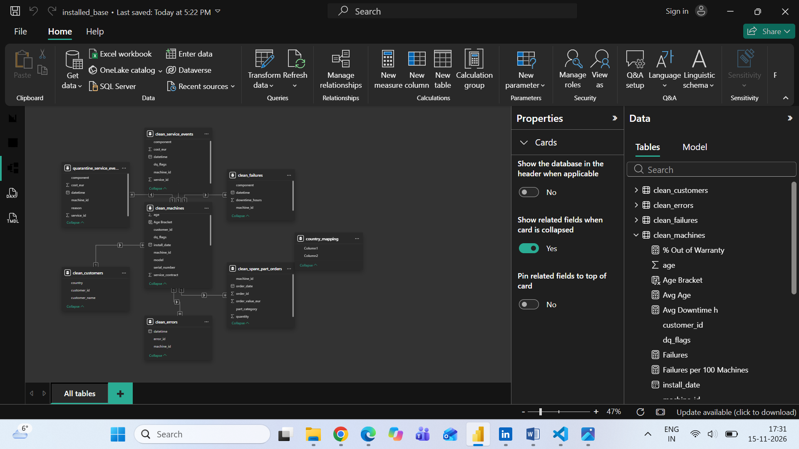

# Installed Base Intelligence

A data pipeline and dashboards that turn messy installed-base data (machines, customers, failures, service events, spare-part orders) into clean, trusted KPIs for service and modernisation decisions.

## Key results
- 150 machines across 30 customers in 8 countries
- Average machine age: 10.3 years; 93% of machines are out of warranty
- 715 failures (about 4.8 per machine over the whole period), average downtime 7.1 hours
- 10 impossible service records (service dated before installation) were caught by the data-quality checks and quarantined instead of silently used

## What it does
1. Loads raw data and checks it against data-quality rules
2. Moves invalid rows into a quarantine table with the reason
3. Builds a clean layer in SQLite and calculates KPIs with SQL
4. Shows the results in a Streamlit dashboard and a Power BI dashboard
5. Runs automatically as a scheduled pipeline (run_pipeline.py / run_pipeline.bat)

## About the data
All data in this project is synthetic and was generated with a seeded Python script, so it is reproducible. Real installed-base data is proprietary, so the dataset imitates a realistic installed base (machines, customers, failures, service events, spare-part orders). Data-quality problems such as inconsistent country names and impossible dates were injected on purpose to test the checks.

## How to run
```
python run_pipeline.py        # runs the full pipeline
streamlit run dashboard.py    # starts the Streamlit dashboard
pytest                        # runs the data-quality tests
```
See docs/data_dictionary.md for the tables and docs/kpis.md for KPI definitions.

## Dashboards
Streamlit screenshots are in docs/screenshots.

## Power BI dashboard
First Power BI project, built to learn the tool. Data model with relationships, DAX measures and three report pages (overview, lifecycle and warranty, service and data quality), built on the exported clean tables.

Open: powerbi/installed_base.pbix (Power BI Desktop). Data: powerbi/data/*.csv, exported with export_for_powerbi.py.






## Next steps with real data
- Connect to the live source systems instead of CSV exports
- Agree master-data rules with the data owners
- Add alerts when data quality drops