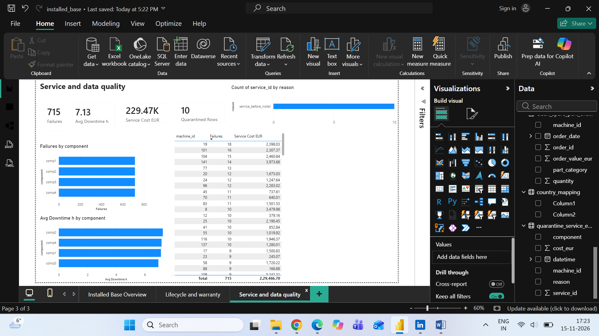

## Power BI dashboard
First Power BI project, built to learn the tool. Data model with relationships, DAX measures and three report pages (overview, lifecycle and warranty, service and data quality), built on the exported clean tables.

Open: powerbi/installed_base.pbix (Power BI Desktop). Data: powerbi/data/*.csv, exported with export_for_powerbi.py.

